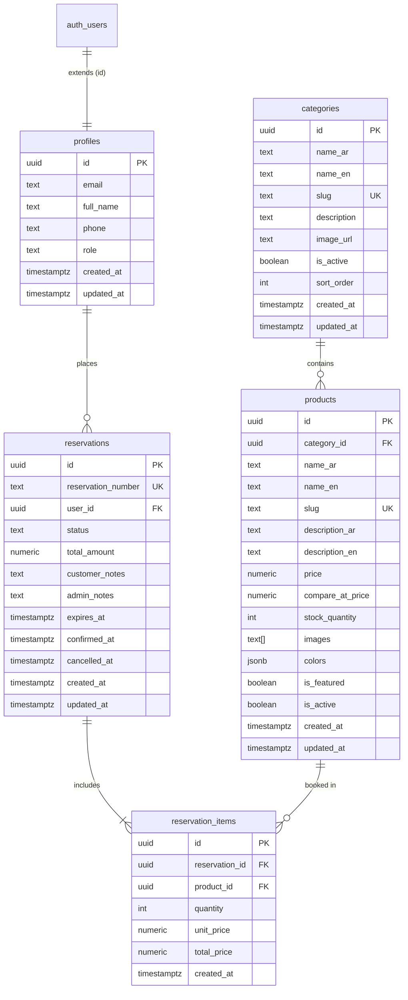
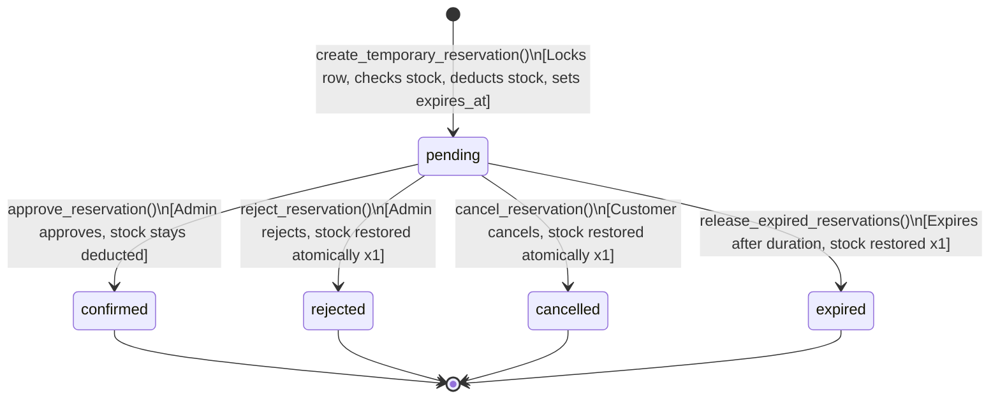

# LUMÉ Store – Database Architecture & Backend Design

This document details the relational PostgreSQL schema, security architecture, and atomic business logic prepared for **LUMÉ Store** (متجر لومي) on Supabase Cloud.

---

## 1. Relational Database Schema



---

## 2. Table Specifications

### 2.1 `profiles`
Extends Supabase's `auth.users` with store customer profile information and access roles.
- `id` (UUID, Primary Key, references `auth.users(id) ON DELETE CASCADE`)
- `email` (TEXT)
- `full_name` (TEXT)
- `phone` (TEXT)
- `role` (TEXT, default `'customer'`, CHECK `role IN ('customer', 'admin')`)
- `created_at`, `updated_at` (TIMESTAMPTZ)

**Automatic User Profile Trigger**:
A PostgreSQL trigger (`on_auth_user_created`) automatically inserts a matching row into `public.profiles` whenever an email signup occurs in `auth.users`.

### 2.2 `categories`
Defines scarf and shawl classifications.
- `id` (UUID, Primary Key)
- `name_ar` (TEXT, e.g., 'أوشحة حريرية فاخرة')
- `name_en` (TEXT, e.g., 'Silk Scarves')
- `slug` (TEXT, Unique, URL-friendly)
- `description` (TEXT)
- `image_url` (TEXT)
- `is_active` (BOOLEAN, default `true`)
- `sort_order` (INT, default `0`)

### 2.3 `products`
The core catalog item holding stock, pricing, and visual attributes.
- `id` (UUID, Primary Key)
- `category_id` (UUID, Foreign Key to `categories(id)`)
- `name_ar` (TEXT, Arabic name)
- `name_en` (TEXT, English name)
- `slug` (TEXT, Unique identifier)
- `description_ar` (TEXT)
- `description_en` (TEXT)
- `price` (NUMERIC(10, 2), CHECK `price >= 0`)
- `compare_at_price` (NUMERIC(10, 2), original crossed-out price)
- `stock_quantity` (INT, default 0, CHECK `stock_quantity >= 0`)
- `images` (TEXT[], array of Supabase Storage URLs)
- `colors` (JSONB, array of color objects e.g. `[{"name": "عنابي", "hex": "#702F40"}]`)
- `is_featured` (BOOLEAN, default `false`)
- `is_active` (BOOLEAN, default `true`)

### 2.4 `reservations`
Customer temporary booking records.
- `id` (UUID, Primary Key)
- `reservation_number` (TEXT, Unique, format: `LUME-YYYYMMDD-XXXX`)
- `user_id` (UUID, Foreign Key to `profiles(id)`)
- `status` (TEXT, CHECK `status IN ('pending', 'confirmed', 'rejected', 'expired', 'cancelled')`)
- `total_amount` (NUMERIC(10, 2))
- `customer_notes` (TEXT)
- `admin_notes` (TEXT)
- `expires_at` (TIMESTAMPTZ, default reservation duration: 60 minutes)
- `confirmed_at` (TIMESTAMPTZ)
- `cancelled_at` (TIMESTAMPTZ)

### 2.5 `reservation_items`
Individual items and quantities captured in each reservation.
- `id` (UUID, Primary Key)
- `reservation_id` (UUID, Foreign Key to `reservations(id) ON DELETE CASCADE`)
- `product_id` (UUID, Foreign Key to `products(id) ON DELETE RESTRICT`)
- `quantity` (INT, CHECK `quantity > 0`)
- `unit_price` (NUMERIC(10, 2))
- `total_price` (NUMERIC(10, 2))

---

## 3. Security & Row Level Security (RLS)

All tables have RLS enabled (`ALTER TABLE ... ENABLE ROW LEVEL SECURITY`).

| Table | Operation | Customer / Public Access | Admin Access |
|---|---|---|---|
| `profiles` | SELECT | Own profile only (`auth.uid() = id`) | All profiles |
| `profiles` | UPDATE | Own profile (role change blocked) | All profiles |
| `categories` | SELECT | Active categories (`is_active = true`) | All categories |
| `categories` | ALL | ❌ Denied | Full insert/update/delete |
| `products` | SELECT | Active products (`is_active = true`) | All products |
| `products` | ALL | ❌ Denied (no direct stock tampering) | Full insert/update/delete |
| `reservations` | SELECT | Own reservations (`user_id = auth.uid()`) | All reservations |
| `reservations` | UPDATE | Controlled strictly via atomic RPCs | Full update |
| `reservation_items`| SELECT | Items belonging to own reservations | All items |
| `storage.objects` | SELECT | Public read (`bucket_id = 'product-images'`) | Public read |
| `storage.objects` | INSERT/DELETE | ❌ Denied | Allowed for `is_admin()` |

### Role Verification Helper: `is_admin()`
```sql
CREATE OR REPLACE FUNCTION public.is_admin()
RETURNS BOOLEAN
LANGUAGE sql STABLE SECURITY DEFINER SET search_path = public AS $$
  SELECT EXISTS (
    SELECT 1 FROM public.profiles
    WHERE id = auth.uid() AND role = 'admin'
  );
$$;
```

---

## 4. Atomic Inventory & Reservation Operations (RPCs)

All inventory-affecting operations run inside PostgreSQL transactions using row-level locking (`SELECT ... FOR UPDATE`) to guarantee zero overselling and eliminate race conditions.



### 1. `create_temporary_reservation(p_items, p_customer_notes, p_duration_minutes)`
- Runs with `SECURITY DEFINER`.
- For each item, acquires row lock on `products` with `SELECT ... FOR UPDATE`.
- Verifies `is_active` and `stock_quantity >= requested_qty`.
- Deducts reserved quantity from `products.stock_quantity`.
- Creates `reservations` and `reservation_items`.
- Expiration timestamp set to `now() + duration`.

### 2. `approve_reservation(p_reservation_id, p_admin_notes)`
- Checks `is_admin()`.
- Locks reservation row `FOR UPDATE`.
- Validates status is `'pending'` and not expired.
- Transitions status to `'confirmed'`. Stock is already deducted.

### 3. `reject_reservation(p_reservation_id, p_admin_notes)`
- Checks `is_admin()`.
- Locks reservation row `FOR UPDATE`.
- Validates status is `'pending'`.
- Transitions status to `'rejected'`.
- Restores item quantities back to `products.stock_quantity` exactly once.

### 4. `cancel_reservation(p_reservation_id)`
- Checks user ownership or `is_admin()`.
- Locks reservation row `FOR UPDATE`.
- Validates status is `'pending'`.
- Transitions status to `'cancelled'`.
- Restores item quantities back to `products.stock_quantity` exactly once.

### 5. `release_expired_reservations()`
- Routine to clean up expired reservations.
- Selects `pending` reservations with `expires_at <= now()` using `FOR UPDATE SKIP LOCKED`.
- Updates status to `'expired'` and restores stock safely.
